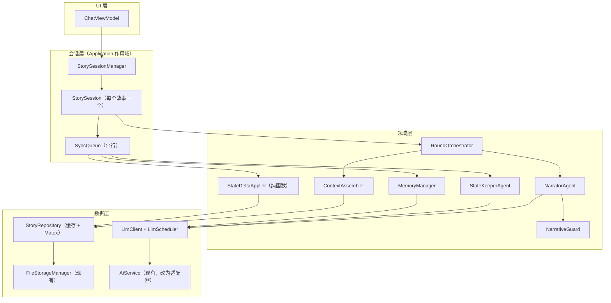
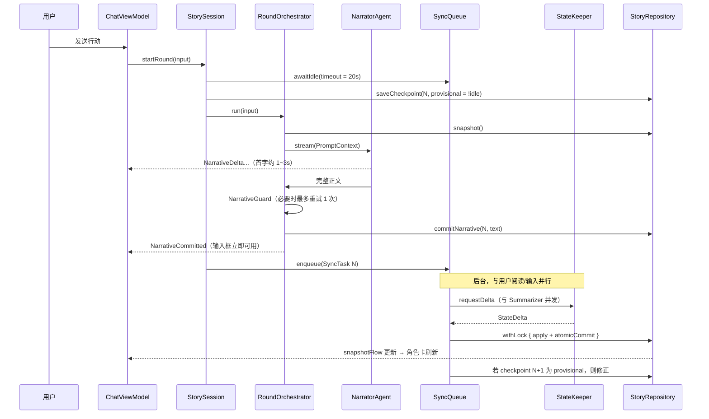
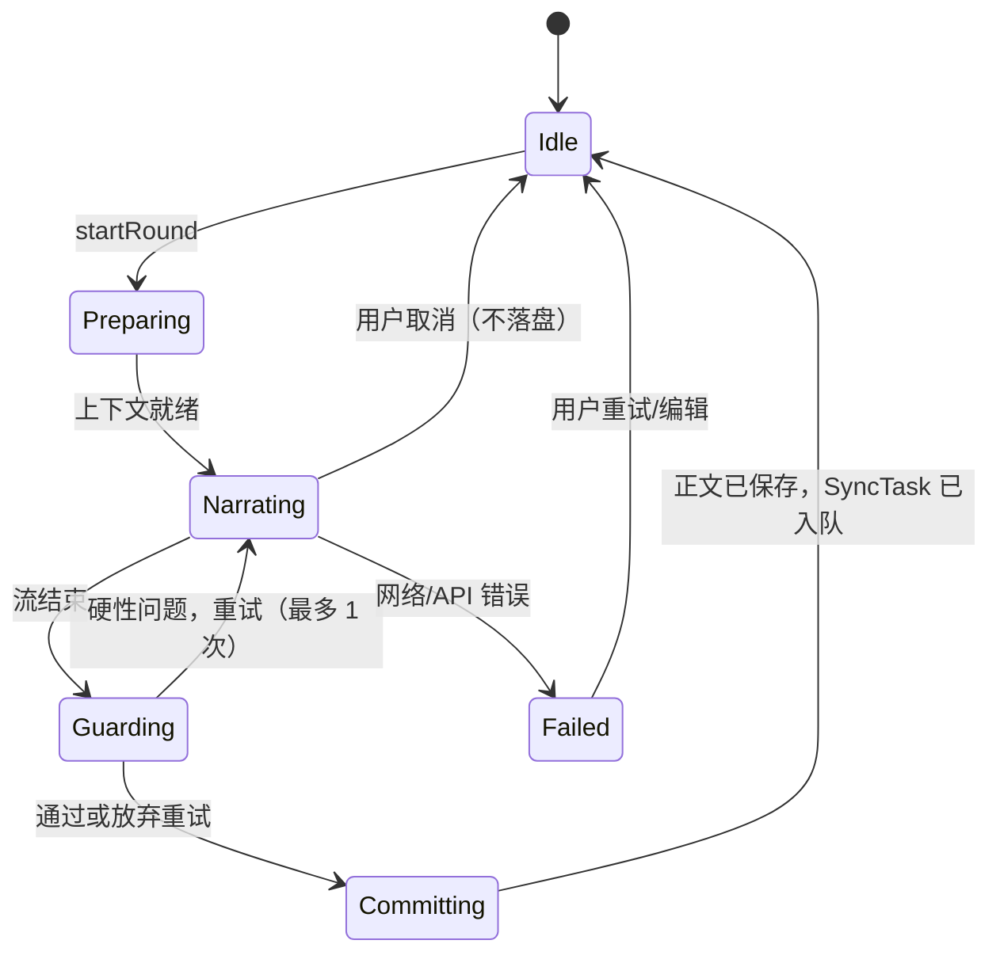

# NovelChat Engine V2 架构设计

> 状态：设计稿，待实施
> 配套文档：[`ENGINE_V2_IMPLEMENTATION_PLAN.md`](ENGINE_V2_IMPLEMENTATION_PLAN.md)（逐任务执行清单）
> 适用版本：基于 `1.0.3`（commit `35b85c6`）的代码现状

---

## 0. 给执行者的阅读须知

1. 先读 `AGENTS.md`。其中的约束全部继续有效：存档向后兼容、不删除用户数据、未经授权不在用户故事上触发真实 AI 生成、构建门禁必须通过。
2. V2 与 V1 **并存**，由开关 `engine_version` 控制。在 Plan 的 T4.2 之前，**不得修改 V1（`RpgGameEngine`）的行为**。
3. 本文的类名和路径是**规范性**的。确有需要可以调整，但要在 PR 说明里写明理由。
4. 所有 prompt 模板都属于“可调参数”。结构（消息顺序、分块、预算）是硬性规定，措辞可以在评测后迭代。

---

## 1. 背景：V1 的结构性问题

| 症状 | 根因 | V2 的对策 |
|---|---|---|
| 慢 | 单回合 4~12+ 次 LLM 调用，全部串行；质量修复最多 3 次全文重写；NPC 逐个调用 | 阻塞路径只保留 **1 次流式调用**；状态同步在后台**合并为 1 次调用**；质量修复最多 1 次，且只针对硬性问题 |
| 状态更新失败 | 巨型 schema（10 个顶层字段、25 条以上规则）；严格校验加 3 次重试；局部失败就把整轮标为 pending 并**锁住输入** | 小 schema，所有字段可选，用操作式增量（op-based delta）；应用器**逐项容错**；同步失败**永不阻塞输入**，自动追补 |
| 语言不自然 | 正文写在 JSON 里；逐字证据和动作清单把写作变成“答题”；正则禁用比喻；约 60 条禁令；没有 system 消息和多轮历史；角色没有声音；固定 1000~1500 字 | 正文用**纯文本流式输出**；SillyTavern 式 prompt 组装；多轮真实历史；正面风格指引加示范；角色卡增加说话方式和示例台词；篇幅自适应 |

**核心原则**（贯穿全部设计）：

> **正文（narrative）是唯一事实源，结构化状态只是派生缓存。**
> 状态落后、缺失或出错，都不能阻止故事继续，因为叙事者能从多轮历史中读到真实发生的事。状态只需要“最终一致”。

---

## 2. 总体架构

### 2.1 分层与模块



### 2.2 新增包结构

```text
app/src/main/java/com/novelchat/
├── session/
│   ├── StorySessionManager.kt      # Application 单例，按 storyId 管理 StorySession
│   ├── StorySession.kt             # 每个故事：叙事 Job、同步队列、SessionState
│   └── SessionState.kt
├── domain/v2/
│   ├── round/
│   │   ├── RoundOrchestrator.kt    # 单回合叙事流程（阻塞路径）
│   │   ├── RoundEvent.kt
│   │   └── LengthPolicy.kt
│   ├── context/
│   │   ├── ContextAssembler.kt     # 从快照构建 PromptContext（纯函数）
│   │   ├── PromptContext.kt
│   │   ├── ContextBudget.kt
│   │   └── CharacterSheetRenderer.kt # 角色卡 → 散文式角色描述
│   ├── prompt/
│   │   ├── NarratorPromptTemplate.kt
│   │   ├── StateKeeperPromptTemplate.kt
│   │   ├── SummarizerPromptTemplate.kt
│   │   └── DefaultStyleGuide.kt
│   ├── narrator/
│   │   ├── NarratorAgent.kt
│   │   ├── NarrativeGuard.kt
│   │   └── NarrativeTextCleaner.kt
│   ├── state/
│   │   ├── StateDelta.kt
│   │   ├── StateDeltaParser.kt
│   │   ├── StateKeeperAgent.kt
│   │   ├── StateDeltaApplier.kt    # 纯函数：(Snapshot, Delta) -> ApplyResult
│   │   ├── ApplyResult.kt
│   │   └── SyncTask.kt
│   └── memory/
│       ├── MemoryManager.kt
│       └── ChapterSummary.kt
├── data/repo/
│   ├── StoryRepository.kt
│   ├── StorySnapshot.kt
│   └── RoundCommitJournal.kt
└── data/remote/llm/
    ├── LlmClient.kt
    ├── LlmRequest.kt
    ├── LlmScheduler.kt
    └── LlmMetrics.kt
```

V1 的 `domain/engine/*` 原样保留，直到 T4.2 才清理。V2 **复用**以下 V1 组件（纯函数，经过测试）：
`CharacterFieldPolicy`、`CharacterReferencePolicy`、`CharacterIdentityPolicy`、`CharacterNamingPolicy`、`CharacterProfilePolicy`、`InventoryTransferPolicy`（只用 prepare/计算部分）、`WorldbookMatcher`、`WorldbookContentPolicy`、`LorePromptSnapshotPolicy`（只用截断工具）、`JsonResponseParser`（只用宽松 JSON 提取工具）、`AtomicTextFile`、`StoredJsonCodec`，以及全部 `data/remote/*Policy`。

---

## 3. 回合生命周期

### 3.1 时序



### 3.2 会话状态机



同步队列有独立的状态：`syncing: Set<Int>`、`failedRounds: Set<Int>`、`lastSyncedRound`。它**不参与**输入框是否可用的判断。

### 3.3 关键规则

| 规则 | 说明 |
|---|---|
| R1 输入可用条件 | `phase == Idle`。与同步状态无关。 |
| R2 回合开始前等待 | `syncQueue.awaitIdle(20s)`，期间 UI 显示“正在整理上一轮…”。超时也继续，并把 checkpoint 标记为 `provisional = true`。 |
| R3 provisional 修正 | Round N-1 的 SyncTask 提交成功后，若 `checkpoint(N).provisional`，用**当前状态**重写 checkpoint N 并清除标记。队列串行，所以此刻的状态恰好等于“N-1 同步后、N 同步前”。 |
| R4 同步串行 | 每个故事一条 `Channel<SyncTask>`，由单个协程消费。不同故事之间可以并行。 |
| R5 任务内并发 | 单个 SyncTask 内，`StateKeeper` 与 `Summarizer`（到期时）用 `async` 并发；提交阶段持有 `repo.writeLock`。 |
| R6 生命周期 | `StorySession` 位于 Application 作用域（`NovelChatApp.applicationScope`）。离开聊天页**不会**取消同步。叙事 Job 随用户取消或页面离开取消（保留 V1 的“返回确认”交互）。 |
| R7 提交原子性 | 提交使用 `RoundCommitJournal`，并包在 `withContext(NonCancellable)` 中执行，见 §7.5。 |
| R8 追补 | SyncTask N 失败 → `failedRounds += N`。下一个 SyncTask（N+1）会自动把失败轮次的正文合并进输入（最多合并 3 轮），统一产出一个 delta。连续 3 轮失败时 UI 显示非阻塞横幅和“重试同步”按钮。 |
| R9 重新生成第 T 轮 | ① 取消叙事 Job；② `syncQueue.cancelFrom(T)`：移除排队中 `round ≥ T` 的任务；正在运行且 `round ≥ T` 的任务若尚未进入提交，则取消；③ 等待正在运行的 `round < T` 任务完成（它会按 R3 修正 checkpoint T）；④ 执行现有的 `restoreRoundCheckpoint(T)`；⑤ `startRound`。 |
| R10 旧存档兼容 | 打开会话时若存在 V1 标记 `state_sync_pending_from_round`，把这些轮次作为一个追补 SyncTask 入队；成功后清除该 flag。 |

---

## 4. LLM 访问层

### 4.1 `LlmRequest` / `LlmClient`

```kotlin
enum class ResponseMode { TEXT, JSON_OBJECT, JSON_SCHEMA }
enum class LlmPriority { FOREGROUND, BACKGROUND }

data class LlmMessage(val role: String, val content: String) // system | user | assistant

data class LlmRequest(
    val stage: AiCallStage,
    val messages: List<LlmMessage>,
    val temperature: Float,
    val maxTokens: Int,
    val responseMode: ResponseMode = ResponseMode.TEXT,
    val jsonSchema: JsonObject? = null,          // 仅 JSON_SCHEMA
    val presencePenalty: Float? = null,          // 端点拒绝时由兼容回退移除
    val frequencyPenalty: Float? = null,
    val priority: LlmPriority = LlmPriority.BACKGROUND,
    val totalTimeoutMs: Long? = null,            // null 时按端点自动取值：远程 90_000，本地 300_000
    val idleTimeoutMs: Long? = null              // 流式 chunk 最大间隔：远程 45_000，本地 90_000
)

interface LlmClient {
    fun stream(request: LlmRequest): Flow<LlmStreamEvent>   // Delta(text) | Finished(reason, usage)
    suspend fun complete(request: LlmRequest): LlmCompletion // text, finishReason, usage
}
```

- 实现 `OpenAiCompatibleLlmClient`，内部复用 `AiService` 的连接选择、`executeRequestWithCompatibilityFallback`、`ChatStreamDecoder`、`BoundedSseLineReader`、错误脱敏等逻辑。**现有 `AiService.chatStream/chatComplete` 签名保持不变**，因为故事导入（`SetupViewModel`）仍在使用。
- 兼容回退链新增两项：端点拒绝时移除 `presence_penalty` 和 `frequency_penalty`。
- `ChatRequest` 增加 `presence_penalty`、`frequency_penalty` 字段（可空，Gson 不序列化 null）。
- `Usage` 增加可选字段 `prompt_cache_hit_tokens`（DeepSeek）和 `prompt_tokens_details.cached_tokens`（OpenAI），用于评估缓存命中。
- `ResponseMode.JSON_OBJECT` 映射到 `response_format: {type: json_object}`，`JSON_SCHEMA` 只在本地端点使用（沿用 `StructuredOutputFormatPolicy` 的判断）。

### 4.2 阶段与路由

`AiCallStage` 新增两个阶段：

| 新 Stage | storageKey | 未单独配置路由时的回退 |
|---|---|---|
| `STATE_KEEPER` | `state_keeper` | 回退到 `task_assignment` 的路由，再回退到默认连接 |
| `SUMMARIZER` | `summarizer` | 回退到 `state_keeper`，再回退到默认连接 |

这样已有用户的“任务分配用便宜模型”配置会自动沿用。`ApiStageRoutes.sanitize` 需要识别新 key。

### 4.3 `LlmScheduler`

```kotlin
class LlmScheduler {
    suspend fun <T> run(endpointKey: String, isLocal: Boolean, priority: LlmPriority, block: suspend () -> T): T
}
```

- **远程端点**：每个端点 `Semaphore(4)`。FOREGROUND 与 BACKGROUND 共享，不设门控。
- **本地端点**（LM Studio 等通常只能串行推理）：`Semaphore(1)`，并且**前台优先**：有 FOREGROUND 请求运行或等待时，新的 BACKGROUND 请求不得获取许可（用 `MutableStateFlow<Int>` 计数前台等待者，BACKGROUND 先 `first { it == 0 }` 再 acquire）。不抢占已在运行的请求。
- `endpointKey = normalizedBaseUrl`。

### 4.4 指标 `LlmMetrics`

每次调用记录：`stage, model, isLocal, ttftMs, totalMs, promptTokens, completionTokens, cachedTokens, finishReason, outcome(ok|retry|error), attempt`。

- 统一写 logcat，TAG 为 `NovelChatPerf`，单行 key=value 格式，便于 `adb logcat | grep` 统计。
- 内存保留最近 200 条的环形缓冲，供 qa 构建的调试面板展示。
- 每回合额外输出一行汇总：`round=N blockingMs=… calls=… syncMs=…`。

---

## 5. 上下文组装（ContextAssembler）

### 5.1 输入与输出

```kotlin
data class StorySnapshot(           // 来自 StoryRepository 内存缓存
    val storyId: Long,
    val world: WorldSetting,
    val story: StoryState,
    val player: PlayerState,
    val characters: List<CharacterCard>,     // 已经过 CharacterIdentityPolicy/ProfilePolicy reconcile
    val worldbook: List<WorldbookEntry>,     // active
    val narratives: List<NarrativeEntry>,    // 按 turn 升序
    val summaries: List<SummaryEntry>,
    val chapters: List<ChapterSummary>,
    val narration: NarrationSettings,
    val version: Long                        // 每次写入后自增
)

data class PromptContext(
    val systemPrompt: String,                // 静态，尽量跨回合不变（利于前缀缓存）
    val history: List<LlmMessage>,           // user/assistant 交替的真实历史
    val turnContext: String,                 // 动态情境块
    val userTurn: String,                    // 最后一条 user 消息 = turnContext + 行动
    val lengthHint: LengthHint,
    val debug: ContextDebugInfo              // 各块字符数、被截断项，供日志
)

object ContextAssembler {
    fun assemble(snapshot: StorySnapshot, input: PlayerInput, budget: ContextBudget): PromptContext
}
```

`ContextAssembler` 必须是**纯函数**（不做 IO，不读系统时间），便于做 golden snapshot 测试。

### 5.2 消息组装顺序（硬性规定）

```text
[0] system    : 叙事者设定 + 文风 + 世界 + 主角档案 + 章节摘要（每 10 轮才变化）
[1..k] user/assistant : 最近 k 轮真实历史（user = “【主角的行动】…”，assistant = 当轮完整正文）
[k+1] user    : 【当前情境】…【在场与相关人物】…【相关设定】…【近期提要】…【本次篇幅】…【主角的行动】<本轮输入>
```

- **为什么动态块放在最后**：前缀缓存（DeepSeek、OpenAI 等自动生效）按前缀匹配。system 加历史在相邻回合之间大部分不变，把每回合都变的情境放末尾，可以最大化缓存命中；同时情境离生成位置最近，模型最重视（对应 SillyTavern 的 Author's Note at depth 0）。
- **只用一个 system 且放在开头**：Gemma 等模型的 chat template 不支持中途的 system 消息，所以动态块并入最后一条 user。
- **历史中的 user 消息**只放玩家原始输入（带前缀），不重复放当时的情境块，避免历史膨胀。

### 5.3 预算 `ContextBudget`

以字符计（中文约 1 字 ≈ 1 token 上下）。远程和本地两档，由路由的 `isLocal` 决定：

| 块 | 远程 | 本地 | 超出时的裁剪策略 |
|---|---|---|---|
| system（不含章节摘要） | 6,000 | 2,500 | 世界 lore 各字段按 `LorePromptSnapshotPolicy` 截断；主角档案只保留身份、性格、背景、说话方式 |
| 章节摘要 | 2,000 | 600 | 保留最近 N 章；更早的合并为“前情总览”一段（由 MemoryManager 生成，见 §9） |
| 历史 | 14,000 | 4,000 | 从最旧一轮开始整轮丢弃；最近一轮必须保留，超长时保留尾部 3,000 字 |
| 情境块 | 5,000 | 2,000 | 依次裁剪：世界书条目数（8→4）→ 相关但不在场人物 → 人物记忆条数 → 待办数量 |

被历史窗口挤出、又不在章节摘要覆盖范围内的轮次，用对应 `SummaryEntry` 填入“近期提要”。

### 5.4 角色选择

复用 `CharacterContextPolicy.selectForNarrative` 的语义，但输出分成两档：
- **在场人物**（`story.activeCharacters` 解析后）：完整角色描述。最多 4 人，超出的降级为相关人物。
- **相关人物**（用户输入或世界书 `relatedCharacters` 提及、但不在场）：一行简介，例如“周明（房东，与林克：紧张）”。最多 4 人。

### 5.5 角色描述渲染（`CharacterSheetRenderer`）

把 JSON 卡片渲染为**散文加少量标签**的形式，不再 dump 原始 JSON：

```text
### 周明（房东，四十多岁；与林克：催租中的紧张关系）
性格：精明、好面子，嘴硬心软。
说话方式：本地口音，爱用反问，说到钱会压低声音。
示例台词：「这个月又拖？你当我开善堂的啊？」「行了行了，周五，最晚周五。」
此刻：烦躁（刚和老婆吵过架）；好感 -10，信任 20/100。
记得：林克上个月帮他修过水管（第 12 轮）；林克答应周五交租（第 18 轮）。
作者备注（角色不会主动透露）：他其实打算卖掉这套房子。
```

- 字段来源：`occupation / age / relationships[player] / personality / lore.speechStyle / lore.sampleDialogues(新) / emotion / mentalState / favor / trust / memories(新, top 3) / lore.secrets`。
- 只渲染 `CharacterFieldPolicy` 中 `display != hidden` 的数值字段，或已在 lore 里的字段。数值统一显示为“标签 值/最大值”。
- `lore.secrets` 和 `is_secret` 的世界书条目放在“作者备注”行，system 中有对应规则（见 §6.2）。
- 没有 `speechStyle` 和 `sampleDialogues` 的旧角色：省略这两行，不编造。

### 5.6 篇幅策略（`LengthPolicy`）

```kotlin
data class LengthHint(val minChars: Int, val maxChars: Int, val maxTokens: Int)
fun LengthPolicy.hint(input: PlayerInput, pref: LengthPreference): LengthHint
```

| 输入类型 | 判定 | 简短 | 标准（默认） | 详细 |
|---|---|---|---|---|
| 续写型 | 非首轮（`narratives.isNotEmpty()`）且命中 `continuationRequests`（复用 V1 的集合）或输入 ≤ 6 字 | 200-400 | 400-700 | 700-1100 |
| 普通（含首轮开局） | 其他（包括 `narratives.isEmpty()` 的首轮自动开场 `"开始这一天"`） | 300-600 | 600-1000 | 900-1400 |
| 复合行动 | 含 ≥ 3 个动作分隔（复用 V1 `actionSeparators` 正则**只用于计数**） | 500-800 | 800-1300 | 1100-1600 |

`maxTokens = maxChars × 2 + 300`（给中文 token 膨胀留余量）。**篇幅只作提示，不做验收**。

---

## 6. 叙事者（NarratorAgent）

### 6.1 请求参数

| 参数 | 远程 | 本地 |
|---|---|---|
| responseMode | TEXT | TEXT |
| temperature | 0.85（可由“创意度”设置调到 0.6~1.0） | 0.7 |
| presence_penalty | 0.3 | 不发送 |
| frequency_penalty | 0.2 | 不发送 |
| maxTokens | `LengthHint.maxTokens` | 同左 |
| priority | FOREGROUND | FOREGROUND |
| thinking / reasoning | 沿用 `ChatRequestPolicy`（DeepSeek 关闭 thinking，本地 Gemma/Qwen 设 `reasoning_effort: none`） | 同左 |

### 6.2 System Prompt 模板（`NarratorPromptTemplate.system`）

> `{}` 为插值；`{?…}` 为可选块，值为空时整块省略。

```text
你是这个互动故事的叙事者：描写世界，并扮演除主角以外的所有角色。玩家扮演主角「{player.name}」。

## 怎么写
- 玩家告诉你主角做了什么、说了什么；你写出接下来发生的事：环境的回应、其他角色的言行，以及行动带来的结果。
- 用{pov}写作，只写主角能看见、听见、感觉到的东西。
- 主角的台词和重大选择属于玩家。玩家给出的行动，你可以写得具体生动；但不要替主角说出玩家没给的关键台词，也不要替他做决定。需要主角表态的时候，让场面停在那里，等玩家。
- 其他角色有自己的目的、情绪和说话方式。他们会主动开口、提要求、隐瞒、拒绝、误会，不只是围着主角转。
- 每次回应都让局面往前走一步：一个新信息、一个人的反应、一处变化，或者一个小麻烦。
- 已经发生的事和世界规则不能推翻。标着“作者备注”的内容是只有你知道的秘密：可以让它影响角色的行为，但角色不会无故说破，主角也不会凭空知道。
- 新出场、和主角有交流的人，给他一个自然的名字，并在正文里用这个名字。

## 文风
{world.lore.narrativeStyle 或 DefaultStyleGuide.zh}
{?## 文风示范（只学语气和节奏，不要复用内容）
{narration.styleSample}}

## 输出
直接写故事正文。不要标题、列表、解释或总结，不要提到“玩家”“回合”“AI”“设定”。

## 世界
{WorldRenderer.prose(world)}

## 主角
{PlayerRenderer.profile(player)}

{?## 前情总览
{chapters.overview}
{chapters.recent}}
```

`{pov}` 的取值：`third_limited` →“第三人称、贴近主角的视角”；`second` →“第二人称（“你”）”。默认 `third_limited`，以兼容现有故事。

### 6.3 默认文风（`DefaultStyleGuide.zh`）

```text
- 写具体的东西：动作、对白、声音、气味、手里的物件。情绪通过人的反应表现出来，而不是直接点名。
- 对白像真人说话：会停顿、打断、答非所问、话说一半。不同的人说话不一样。
- 节奏有快有慢：紧张时用短句；平静时可以舒展一些。比喻偶尔用，用就用准。
- 赶路、等待这类过场一两句带过，把笔墨留给人和事。
- 篇幅跟着内容走：事情多就多写，事情少就少写，不要为了凑字数重复。
```

**注意**：只写正面指引，不再列举禁用词。V1 的禁用模式（“仿佛”“似乎”等）**不得**迁入 V2。

### 6.4 情境块模板（`NarratorPromptTemplate.turnContext`）

```text
【当前情境】
{story.timeOfDay}｜{story.currentLocation}｜{story.weather}
{?画面：{story.sceneDescription}}
在场：{presentNames 或 “只有{player.name}”}
{player.name}现状：{PlayerRenderer.status(player)}   # 只放 dynamic 字段和异常状态（受伤、饥饿等），≤ 120 字
当前目标：{currentGoal}{?；其他待办：{pending[1..3]}}

【在场人物】
{CharacterSheetRenderer.full(present)}

{?【相关人物】
{CharacterSheetRenderer.brief(related)}}

{?【相关设定】
- {entry.name}：{entry.description ≤ 200 字}}

{?【近期提要】
{summaries outside history window, “第N轮：…” 每行一条}}

{?【人物指代】
用户说的“{reference}”指的是{name}（{relationship}）。}      # 复用 NarrativeIdentityAnchorPolicy.resolve 的结果，只作提示

【本次篇幅】大约 {min}-{max} 字。

【主角的行动】
{input}
```

历史中的 user 消息格式：`【主角的行动】\n{userInput}`。

### 6.5 输出后处理（`NarrativeTextCleaner`，确定性，不调用 LLM）

1. 去掉首尾空白、代码围栏、Markdown 标题（`^#+ `）和列表符号开头的行（转成普通段落）。
2. 去掉常见的模型前言或后语：以“好的”“以下是”“（本轮完）”“---”开头或结尾的行。
3. 若整段被 JSON 包裹（某些模型的习惯），尝试提取 `narrative` 字段。
4. 统一段落分隔为 `\n\n`；合并 3 个及以上的连续空行。
5. `finish_reason == length` 时，截到最后一个完整句末标点（。！？…」”），**不发起补写请求**。
6. 执行 `CharacterNamingPolicy.normalizeNarrativeText`（V1 已有的占位名替换）。

### 6.6 硬性检查（`NarrativeGuard`）

```kotlin
sealed interface GuardVerdict { object Pass; data class Retry(val reason: GuardReason); data class Fail(val reason: GuardReason) }
enum class GuardReason { EMPTY, TOO_SHORT, REPETITION, META_LEAK }
```

| 检查 | 条件 | 处理 |
|---|---|---|
| EMPTY | 清理后为空 | Retry；重试后仍为空则 Fail |
| TOO_SHORT | 非空白字符 < 80 | Retry |
| REPETITION | 与上一轮正文的 8-gram 重合率 > 40%，或最长公共子串 > 200 字 | Retry（temperature +0.1，presence_penalty 0.6；在情境块末尾追加一句：“上一段已经写过的内容不要重复，从它结束的地方接着写。”） |
| META_LEAK | 命中 `(作为(一个)?AI|语言模型|JSON|提示词|玩家输入|第\s*\d+\s*轮)` | **不重试**，删除命中的整句 |

- **全回合最多 1 次重试**。重试时向 UI 发出 `NarrativeReset`，清空已显示的流式文本，并显示“重新生成中…”。
- 主角代言检测（V1 `NarrativeAgencyPolicy`）在 V2 中**只记日志**，不重试。
- 字数偏差、文风、动作覆盖：**不检查**。

### 6.7 提交

`RoundOrchestrator.commit`：在 `repo.writeLock` 下写入 `NarrativeEntry(turn = N)`，更新 `story.currentRound = N`，然后发出 `NarrativeCommitted`，再 `syncQueue.enqueue(SyncTask(rounds = [N] + 待追补轮次))`。
**V2 中 SummaryEntry 由 StateKeeper 生成**，叙事阶段不写摘要。

---

## 7. 状态同步（StateKeeper）

### 7.1 `StateDelta` 结构

所有字段**可选**。省略表示“无变化”。

```json
{
  "summary": "一句话：本轮实际发生了什么（≤60字）",
  "scene": {
    "location": "正文结尾时主角所在地点",
    "time_of_day": "傍晚",
    "weather": "小雨",
    "present": ["正文结尾时与主角在同一现场的人物姓名"],
    "description": "一句话描述结尾画面"
  },
  "goals": {
    "complete": ["已彻底完成的待办（原文或近似表述）"],
    "add": ["新出现的具体待办"],
    "update": [{"from": "旧待办", "to": "按最新进展改写后的待办"}],
    "current": "主角此刻最主要的目标（可选）"
  },
  "player": {
    "fields": {"stamina": "62", "stress": "中"},
    "inventory": [{"op": "add", "item": "钥匙", "qty": 1}],
    "relationships": [{"name": "周明", "stage": "勉强信任"}]
  },
  "npcs": [
    {
      "name": "周明",
      "emotion": "松了口气",
      "favor_delta": 5,
      "trust_delta": 3,
      "relationship_stage": "勉强信任",
      "fields": {"stress": "低"},
      "memory": "林克当面保证周五交租",
      "inventory": [{"op": "remove", "item": "备用钥匙", "qty": 1}]
    }
  ],
  "new_npcs": [
    {
      "name": "许棠",
      "identity": "楼下便利店店员",
      "relationship_to_player": "初识",
      "gender": "女", "age": 22,
      "personality": "爽朗，爱八卦",
      "appearance": "短发，围裙上别着卡通徽章",
      "speech_style": "语速快，爱用感叹词",
      "fields": {}
    }
  ],
  "departed": [{"name": "周明", "permanent": false}],
  "transfers": [{"item": "备用钥匙", "qty": 1, "from": "周明", "to": "林克"}],
  "world": [{"name": "海临市第三医院", "type": "location", "description": "…", "keywords": ["三院"]}],
  "events": [{"title": "房租延期", "description": "周明同意林克延期到周五", "related": ["周明"]}],
  "suggestions": ["敲开周明的门道谢", "去便利店找许棠打听消息", "回房间整理简历"]
}
```

与 V1 `TaskAssignment` 的主要区别：
- **待办改为操作式**（complete/add/update），模型不必重写完整列表，少一大类错误。
- NPC 状态**内联**，不再“先列出要更新的人、再逐个调用”。
- 删除 `sync_status`、`no_change_reason`、`character_updates.reason`、`retired_characters` 与 `departed` 的分歧等纯校验用字段。
- 新增 `memory`（NPC 记忆）和 `suggestions`（替换写死的 `ActionSuggestionPolicy`，其文案如“查看手机上的消息”只适合现代城市题材）。

### 7.2 两档 Schema

| 档位 | 使用条件 | 包含字段 |
|---|---|---|
| FULL | STATE_KEEPER 路由为远程 | 全部 |
| COMPACT | 路由为本地 | `summary, scene, goals, player.fields, player.inventory, npcs[name, emotion, favor_delta, memory], new_npcs[name, identity, relationship_to_player], suggestions` |

请求参数：`responseMode = JSON_OBJECT`（远程）或 `JSON_SCHEMA`（本地，schema 由 `StateKeeperSchemas` 生成，`strict = false`）；`temperature = 0.2`；`maxTokens = 1800`（FULL）或 `1000`（COMPACT）；`priority = BACKGROUND`。

### 7.3 StateKeeper Prompt

**system**（每个故事基本不变，可被缓存）：

```text
你是互动小说的记录员。阅读本轮剧情，把它对人物和世界造成的变化记成一份 JSON。

规则：
1. 只记录正文里实际发生的变化。不确定的就不写。所有字段都可以省略；什么都没变就输出 {"summary": "…"}。
2. 人物一律使用【已知人物】里的原名。正文里首次出场、和主角有互动的人放进 new_npcs，并给出名字和身份。
3. 角色字段写本轮结束时的最终值，必须符合【字段说明】中的类型和范围。update_mode 为 manual 的字段不要写。
4. 好感、信任写变化量 favor_delta 和 trust_delta（通常在 -10 到 +10 之间）。
5. 待办：彻底完成的放进 complete；有进展但没完成的用 update 改写；新出现的放进 add。
6. 角色之间交接物品写 transfers；从环境中获得或消耗的物品写 player.inventory 或 npcs[].inventory。同一件事只记一次。
7. scene.present 只写正文结尾时和主角在同一现场的人（打电话、发消息的另一方不算）。
8. npcs[].memory：这个角色以后会记得的一件事，一句话；没有就不写。
9. suggestions：给出 3 个玩家接下来可能想做的事，每条 15 字以内，贴合当前局面，彼此不同。
10. 只输出 JSON。

【字段说明】
{CharacterFieldPolicy.effectiveDefinitions 渲染为：key｜label｜类型/范围/选项｜适用对象｜update_mode｜description}

【输出格式示例】
{FULL 或 COMPACT 的示例 JSON，即 §7.1 的结构，值用占位说明}
```

**user**（每次变化）：

```text
【当前状态】
场景：{location}｜{timeOfDay}｜{weather}；在场：{present}
待办：{pending 编号列表}
{player.name}：{dynamic 字段的 key=value}；物品：{inventory 名称×数量}

【已知人物】
{每人一行：姓名｜身份｜与主角关系阶段｜好感/信任｜情绪}       # 只列在场、相关、正文中出现的人；正文中出现的名字用 CharacterReferencePolicy 预先解析

{?【之前未记录的剧情】         # 追补轮次（R8）
第{n}轮 行动：{input}
{narrative}}

【本轮】
行动：{input}
正文：
{narrative}
```

### 7.4 应用器 `StateDeltaApplier`（纯函数）

```kotlin
data class ApplyResult(
    val snapshot: StorySnapshot,          // 应用后的新快照（内存）
    val writes: List<EntityWrite>,        // 需要落盘的实体（after 状态或删除）
    val issues: List<ApplyIssue>,         // INFO / WARN，仅用于日志和调试
    val summary: SummaryEntry?,
    val suggestions: List<String>
)
object StateDeltaApplier {
    fun apply(base: StorySnapshot, delta: StateDelta, rounds: List<Int>, now: String): ApplyResult
}
```

逐项语义（**任何一项出问题都只记 issue 并跳过该项，不抛异常**）：

| 项 | 规则 |
|---|---|
| 名字解析 | 先在 `new_npcs` 中按名字匹配，再用 `CharacterReferencePolicy.resolve(cards, name)`。主角别名（主角姓名、“主角”、“我”、“玩家”）映射为 player。 |
| `new_npcs` | 名字已存在（经 resolve）→ 不新建，改为合并到 `npcs` 处理。否则按 V1 新角色的构造逻辑建卡（`CharacterNamingPolicy.normalizeNpcCard` + `CharacterFieldPolicy.normalizeImportedAttributes` + `CharacterProfilePolicy.reconcile`），`lore.speechStyle = speech_style`。占位名（V1 `CharacterNamingPolicy` 判定）→ 跳过并记 WARN。 |
| `npcs[]` | 解析失败 → 若该名字出现在本轮正文中且为合法人名，按最小卡片创建（identity 留空）；否则跳过。`emotion` 同时写 `emotion` 和 `mentalState.mood`。`favor/trust_delta` 先限制在每轮 ±15，再 clamp 到 (-100..100 / 0..100)。`fields` 经 `CharacterFieldPolicy.sanitizeValue`，跳过 manual 和未知 key。`memory` 追加到 `memories`（见 §9.2）。 |
| `player.fields` | 同上，复用 V1 `applyPlayerAttributes` 的 key→属性映射（迁入 `PlayerFieldMapper`，供 V1/V2 共用）。 |
| inventory op | `add` 累加（1..9999）；`remove` 不存在时记 INFO 并忽略；数量不足时移除全部。 |
| `transfers` | 用 `InventoryTransferPolicy.prepare` 计算，源库存不足则跳过。**不写** per-transfer journal（整轮原子提交已覆盖）。 |
| `goals` | 规范化匹配（去空白和标点后相等或包含）：`complete` 删除匹配项；`update` 替换；`add` 去重后追加；列表上限 8 条（超出丢弃最旧的）。`current` 非空 → 写 `player.storyProgress.currentGoal`；否则取 pending 第一项（复用 `PlayerGoalPolicy.alignWithPendingEvents`）。 |
| `scene` | 非空字段覆盖。`present` 逐个解析，无法解析的丢弃。 |
| `departed` | `permanent = true` → 卡片 `status = "pool"`，并从 present 移除；`false` → 只从 present 移除。 |
| `world` | 按名字（`WorldbookContentPolicy.normalizeName`）匹配已有条目则更新 description/keywords；否则新建 `id = "wb_{round}_{hash8}"`。 |
| `events` | 沿用 V1 `applyEventRecords` 的语义：追加到 related 第一个可定位条目的 `statusHistory`，否则新建 event 条目。 |
| `summary` | 生成 `SummaryEntry(turn = rounds.last())`；追补时摘要涵盖多轮，写在最后一轮。 |
| `story.activeCharacters` | 若 `scene.present` 存在则使用它；否则保持原值，并加入本轮新建的 NPC。 |

### 7.5 原子提交 `RoundCommitJournal`

取代 V1 的逐实体 `StateMutationJournal` 和 `InventoryTransferJournal`（V1 的这些文件继续保留，供 V1 使用和读取）：

```kotlin
data class RoundCommitJournal(
    val version: Int = 1,
    val rounds: List<Int>,
    val status: String,                       // prepared | completed
    val writes: List<EntityWrite>
)
data class EntityWrite(
    val type: String,                         // player | character | worldbook | story | summary | checkpoint
    val key: String,                          // 文件定位键
    val after: JsonElement?                   // null = 删除
)
```

流程（在 `withContext(NonCancellable) { repo.writeLock.withLock { … } }` 中执行）：
1. 原子写入 `sync/commit_{lastRound}.json`，`status = prepared`。
2. 依次执行每个 write（都是 after 全量写，**天然幂等**）。
3. 把 journal 改写为 `completed`，更新 `sync/status.json`，然后删除 journal。
4. 更新内存快照，`version++`，`snapshotFlow.emit`。

崩溃恢复：`StorySession` 打开时扫描 `sync/commit_*.json`，对 `prepared` 的 journal 重放步骤 2~3。

### 7.6 失败处理

| 失败点 | 处理 |
|---|---|
| 网络/HTTP 错误 | `AiService` 层已有响应前重试，SyncTask 层不再重试 → 标记 failed，等下一轮追补 |
| JSON 解析失败 | 先用 `JsonResponseParser` 的宽松提取（去代码围栏、截取首个完整对象、修复尾逗号）。仍失败 → **重试 1 次**，在 user 末尾追加“上次输出不是合法 JSON，请只输出 JSON 对象”。仍失败 → failed |
| 解析成功但内容有问题 | 由应用器逐项跳过，SyncTask 视为**成功** |
| 提交 IO 失败 | journal 保证可重放；SyncTask 视为 failed，下次打开会话时恢复 |

`sync/status.json`：`{ "last_synced_round": 17, "failed_rounds": [18], "last_error": "…", "updated_at": "…" }`

### 7.7 同步任务内的并发

```kotlin
suspend fun runSyncTask(task: SyncTask) = coroutineScope {
    val base = repo.snapshot(task.storyId)
    val deltaJob = async { stateKeeper.request(base, task) }                    // 必需
    val chapterJob = if (memory.chapterDue(base, task)) async { memory.summarizeChapter(base, task) } else null
    val delta = deltaJob.await()                                                 // 失败 → 抛给上层标记 failed
    val result = StateDeltaApplier.apply(repo.snapshot(task.storyId), delta, task.rounds, clock.now())
    val chapter = chapterJob?.let { runCatching { it.await() }.getOrNull() }     // 章节摘要失败不影响主同步
    repo.commit(task, result, chapter)                                           // §7.5
    patchProvisionalCheckpoint(task.rounds.last() + 1)                           // R3
}
```

注意：apply 时应**重新读取**快照，而不是用 `base`。因为在 LLM 调用期间，用户可能在角色页手动编辑过卡片，需要合并到最新状态上。

---

## 8. 存储与仓库（StoryRepository）

### 8.1 职责

```kotlin
class StoryRepository(private val files: FileStorageManager) {
    fun writeLock(storyId: Long): Mutex
    suspend fun snapshot(storyId: Long): StorySnapshot            // 内存缓存，首次加载时全量读盘
    fun snapshotFlow(storyId: Long): StateFlow<StorySnapshot?>
    suspend fun commitNarrative(storyId: Long, entry: NarrativeEntry)
    suspend fun commit(task: SyncTask, result: ApplyResult, chapter: ChapterSummary?)
    suspend fun saveCheckpoint(storyId: Long, round: Int, provisional: Boolean)
    suspend fun patchCheckpointIfProvisional(storyId: Long, round: Int)
    suspend fun restoreCheckpoint(storyId: Long, round: Int)       // 委托现有实现，然后 invalidate
    suspend fun <T> edit(storyId: Long, block: suspend (FileStorageManager) -> T): T  // 其他页面手动编辑的统一入口：加锁、执行、invalidate
    fun invalidate(storyId: Long)
}
```

### 8.2 要求

- **所有写操作与首次读盘均须经过 `writeLock`**（因为 `FileStorageManager.loadAllNarratives` 和 `AtomicTextFile.recoverDirectory` 会在读盘时顺带清理/修复文件）。`CharacterViewModel`、`WorldbookViewModel`、`CharacterConfirmViewModel` 中访问 `fileStorage` 的地方，在 V2 开启时改走 `repo.snapshot` / `repo.edit {}`。`MainLobbyViewModel.deleteConversation` 删档前必须先调用 `sessionManager.closeSession(id)` 取消后台任务。V1 路径不变。
- 缓存解决了 V1 每回合 `loadAllNarratives`、`loadAllCharacterCards` 反复全量读盘的问题。缓存只在提交或 `edit` 后更新或失效。
- 快照的 `narratives` 列表在内存中保留全部（文本量可控：1000 轮约 1~1.5 MB）。超过 2000 轮再考虑分页，本期不做。
- `RoundCheckpoint` 增加 `provisional: Boolean = false`，`CURRENT_VERSION = 2`；`FileStorageManager.restoreRoundCheckpoint` 必须放宽为 `checkpoint.version in 1..RoundCheckpoint.CURRENT_VERSION` 以兼容 V1 检查点（当前代码为 `==` 严格相等）。
- `StoryRepository.restoreCheckpoint(storyId, round)` 在委托 `FileStorageManager.restoreRoundCheckpoint` 后，须同步清理 `round` 及之后的 `sync/commit_*.json`、截断 `sync/status.json`，以及删除 `toTurn >= round` 的 `memory/chapters/*.json`，最后 `invalidate(storyId)`。

### 8.3 新增文件（全部为增量，旧存档不需要迁移）

```text
{appFiles}/rpg/{storyId}/
  ├── narration.json                 # NarrationSettings（不存在时用默认值）
  ├── memory/chapters/{index}.json   # ChapterSummary
  └── sync/
      ├── status.json
      └── commit_{round}.json        # 仅在提交过程中短暂存在
```

---

## 9. 记忆（MemoryManager）

### 9.1 三层记忆

| 层 | 内容 | 生成方式 | 进入 prompt 的位置 |
|---|---|---|---|
| L0 原文 | 最近 k 轮完整正文 | 现有 | 多轮 history |
| L1 回合摘要 | 每轮一句（`SummaryEntry`） | StateKeeper 的 `summary` | 情境块“近期提要”（仅窗口外、章节未覆盖的轮次） |
| L2 章节摘要 | 每 10 轮一段 200~300 字 | Summarizer（后台，与 StateKeeper 并发） | system“前情总览” |
| L2+ 总览 | 章节数 > 6 时，把最早的章节递归合并为一段 ≤ 600 字的“前情总览” | Summarizer | system“前情总览” |

`chapterDue`：`lastSyncedRound - lastChapter.toTurn ≥ 10`。

**Summarizer prompt**（输出纯文本，`responseMode = TEXT`，temperature 0.3，maxTokens 600）：

```text
system: 你在为一部长篇互动小说写章节梗概。要写清楚：发生了哪些关键事件，人物关系有什么变化，留下了哪些悬念和承诺。只写事实，不评价，200-300 字。
user:
【上一章梗概】{prev or 无}
【本章各回合摘要】
第{n}轮：{summary}
...
【本章最后一轮正文节选】{last narrative 尾部 800 字}
```

### 9.2 NPC 记忆（Generative Agents 简化版）

```kotlin
data class MemoryNote(
    @SerializedName("turn") val turn: Int = 0,
    @SerializedName("text") val text: String = "",
    @SerializedName("weight") val weight: Int = 1      // 1 普通，2 重要（涉及承诺、冲突、秘密、物品交接时由应用器判定为 2）
)
// CharacterCard 新增：@SerializedName("memories") val memories: List<MemoryNote> = emptyList()
```

- 应用器追加 `npcs[].memory`。同一角色最多保留 30 条，超出时先淘汰 `weight = 1` 中最旧的。
- 进入 prompt 的条目（每人最多 3 条）：按 `weight × 10 − (currentRound − turn)` 排序取前 3。
- 本期不做向量检索（端侧成本和依赖都较重）。世界书仍用关键词匹配，由 `WorldbookMatcher` 负责。

---

## 10. UI 与交互

### 10.1 ChatViewModel（V2 模式）

- 观察三条流：`session.roundEvents`（叙事）、`session.state`（同步）、`repo.snapshotFlow`（卡片和场景）。
- 输入框可用条件：`isReady && session.phase == Idle`。**删除** V2 下 `ChatInputPolicy` 的 `pendingSyncRound` 阻断（V1 保留）。
- 角色面板标题旁显示同步状态小标签：同步中（转圈）→ 已更新（2 秒后淡出）/ 部分未更新（可点击重试）。
- 失败横幅只在 `failedRounds.size ≥ 3` 时出现，可关闭，并提供“重试同步”按钮（调用 `session.retrySync()`）。
- 行动建议改为显示 `suggestions`（来自最近一次 delta）；没有时回退到 `ActionSuggestionPolicy`。
- 生成中返回：沿用 V1 的确认对话框，但文案改为“停止生成？（已保存的状态同步会在后台继续）”。

### 10.2 设置项

> 现状说明：目前项目中只有 `ApiSetupScreen.kt`（从欢迎页或大厅齿轮进入）和只读的 `CharacterDetailScreen.kt`。因此下表同时明确挂靠入口：

| 位置 | 项 | 存储 |
|---|---|---|
| `ApiSetupScreen` › 叙事与引擎（新增分区） | 引擎版本 V1 / V2；默认篇幅：简短 / 标准 / 详细；创意度：稳定 / 平衡 / 奔放（对应 temperature 0.65 / 0.85 / 1.0） | DataStore `engine_version`、`narration_length`、`narration_creativity` |
| `ApiSetupScreen` › 高级调用路由 | 新增 `STATE_KEEPER`（状态同步）与 `SUMMARIZER`（章节摘要）两行 | DataStore `api_stage_routes` |
| `ChatScreen` 菜单 › 叙事设置（新增弹窗） | 人称：第三人称 / 第二人称；文风示范（多行文本，≤ 800 字）；覆盖全局篇幅 | `narration.json` |
| `CharacterDetailScreen` › 编辑设定（新增弹窗） | 说话方式（`lore.speechStyle`）、示例台词（`lore.sampleDialogues`，最多 5 条） | 角色卡（经 `repo.edit` 保存） |

### 10.3 qa 构建的调试面板

聊天页菜单 › “性能”（`app/build.gradle.kts` 的 `buildFeatures` 须开启 `buildConfig = true`，仅 `BuildConfig.DEBUG || BuildConfig.BUILD_TYPE == "qa"` 可见）：
- 最近 10 回合的时间线：各阶段的 TTFT、总时长、token 数、缓存命中 token。
- 最近一次 PromptContext 各块的字符数和被裁剪项（`ContextDebugInfo`）。
- 最近一次 ApplyResult 的 issues。

---

## 11. 数据模型变更汇总（全部向后兼容）

| 模型 | 变更 | 兼容方式 |
|---|---|---|
| `CharacterLore` | `+ sample_dialogues: List<String> = []` | Gson 缺字段时取默认值 |
| `CharacterCard` | `+ memories: List<MemoryNote> = []` | 同上 |
| `RoundCheckpoint` | `+ provisional: Boolean = false`，`CURRENT_VERSION = 2` | 同上；`FileStorageManager.restoreRoundCheckpoint` 放宽为 `version in 1..CURRENT_VERSION` |
| `NarrationSettings`（新） | `pov`, `length`, `style_sample` | 文件不存在时用默认值 |
| `ChapterSummary`（新） | `index, from_turn, to_turn, text, created_at` | 新文件 |
| `ChatRequest` | `+ presence_penalty?`, `+ frequency_penalty?` | 可空，不序列化 null |
| `Usage` | `+ prompt_cache_hit_tokens?`, `+ prompt_tokens_details?` | 可空 |
| 遗留字段 | **只改 Kotlin 属性名，JSON key 不变**：`cv → risk`、`alpha → willpower`、`resistance → resilience`、`huntingSkill → actionSkill`、`libido → actionTendency`、`threshold → defenseThreshold`、`kink → hiddenClue` | `@SerializedName` 保留原 key，存档零迁移。此项放在 T4.2，避免与 V1 并行期产生大面积冲突 |

---

## 12. 评测与验收

### 12.1 离线评测工具（T4.1）

- 形式：`androidTest`（qa 构建）或 JVM 测试加真实 API。API Key 从 `local.properties` 的 `novelchat.evalApiKey` 读取，**不提交**。
- 场景：`app/src/androidTest/assets/eval/*.json`，每个场景 = 初始故事（复用 docs 中的示例 JSON 和默认故事）+ 10 条固定玩家输入。至少覆盖：现代默认故事、魔法学院、多 NPC 社交、物品交易、长程续写（30 轮）。
- 在**测试专用的故事目录**中运行，绝不触碰用户故事。
- 输出 `build/eval/{timestamp}/report.json` 和 `transcript.md`（V1 与 V2 各一份，便于盲评）。

### 12.2 指标与目标（远程 DeepSeek 默认模型）

| 指标 | V1 基线（T0.1 实测后回填） | V2 目标 |
|---|---|---|
| 首字时间 TTFT p50 | 待测 | ≤ 3s |
| 输入恢复可用时间 p50 | 待测 | ≤ 叙事流结束 + 1s |
| 每回合阻塞路径 LLM 调用数 | 待测 | 平均 ≤ 1.1 |
| 每回合总 LLM 调用数 | 待测 | 平均 ≤ 2.3 |
| 同步成功率（SyncTask 成功 / 总数） | 待测 | ≥ 95% |
| 因同步问题导致输入被阻塞 | 存在 | 0 |
| 盲评“更自然、更像小说”偏好率 | — | V2 ≥ 70% |
| 盲评“角色区分度” | — | V2 ≥ 70% |
| 状态准确性抽检（地点、在场、关键物品、主要关系） | 待测 | 不低于 V1 − 5% |

本地模型（Qwen3.5 4B / Gemma4）：要求能完成 10 轮、无阻塞、无崩溃；同步成功率 ≥ 80%。

---

## 13. 风险与对策

| 风险 | 对策 |
|---|---|
| 去掉严格校验后，状态准确性下降 | 评测中的状态抽检；应用器的合理性约束（每轮 delta 上限、名字解析）；正文仍是事实源，叙事者从历史中自我纠正 |
| 纯文本叙事替主角说话的情况增多 | system 中的明确规则；日志统计 `NarrativeAgencyPolicy` 命中率；若超过 10%，再考虑轻量提醒（仍不重写） |
| 并发写导致数据竞争 | 统一 `writeLock`；所有写入口收敛到 Repository；增加并发测试 |
| 后台同步与重新生成交错 | R9 的严格顺序；`NonCancellable` 提交；对 provisional checkpoint 的测试 |
| 前缀缓存因服务商而异 | 只是收益项，不是正确性依赖；用指标中的 cachedTokens 观察 |
| 本地模型并发拖慢叙事 | `LlmScheduler` 对本地端点串行且前台优先 |
| V1/V2 并存期维护成本 | V2 只新增代码；共用组件只抽取不改语义；T4.2 统一清理 |

---

## 14. 开源设计参考

| 来源 | 借鉴点 | 许可提醒 |
|---|---|---|
| SillyTavern | prompt 组装顺序、Author's Note 深度注入、World Info、示例对白 | AGPL-3.0：只借鉴设计，不拷贝代码 |
| Character Card V2/V3 规范 | `description / personality / scenario / mes_example / character_book` 字段语义；后续导入兼容 | 规范开放 |
| Generative Agents（Park et al., 2023） | 记忆流、重要度、周期性反思 → NPC 记忆和章节摘要 | 论文 |
| MemGPT / Letta | 核心记忆与档案记忆分层；“记录员”以增量方式编辑状态 | Apache-2.0（只借鉴设计） |
| AI Dungeon（Story Cards / Memory） | 关键词触发的设定卡、前情摘要 | 产品设计参考 |
