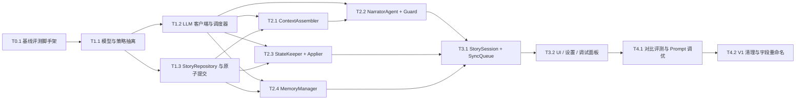

# NovelChat Engine V2 逐任务实施计划

> 配套设计文档：[`ENGINE_V2_DESIGN.md`](ENGINE_V2_DESIGN.md)
> 适用代码基线：`1.0.3`（commit `35b85c6`）
> 通用构建门禁（每个任务完成后均须通过）：
> ```bash
> export ANDROID_HOME="$HOME/Library/Android/sdk"
> ./gradlew testDebugUnitTest lintDebug app:compileDebugAndroidTestKotlin assembleDebug
> ```

---

## 0. 执行约束与代码现状备忘

执行本计划的开发者/Coding Agent 开始编码前须注意以下已核实的代码现状：

1. **V1 零破坏原则**：在 `T4.2` 之前，`RpgGameEngine`、`RpgPromptBuilder`、`NarrativeQualityPolicy` 等 V1 行为不得改变，已有 `236+` 单测和 `FileStorageManagerInstrumentedTest` 必须持续通过。
2. **代码实际位置（与常见误猜的区别）**：
   - `Routes` 定义在 [`ui/navigation/NavGraph.kt`](../app/src/main/java/com/novelchat/ui/navigation/NavGraph.kt)，而非单独的 `Routes.kt`。
   - `ChatUiState`、`ChatMessageItem` 定义在 [`ui/viewmodel/ChatUiModels.kt`](../app/src/main/java/com/novelchat/ui/viewmodel/ChatUiModels.kt)。
   - `ChatStreamCompletionPolicy` 定义在 [`data/remote/ChatStreamDecoder.kt`](../app/src/main/java/com/novelchat/data/remote/ChatStreamDecoder.kt) 内。
   - `CharacterFieldPolicy` 定义在 [`data/model/CharacterFieldDefinition.kt`](../app/src/main/java/com/novelchat/data/model/CharacterFieldDefinition.kt) 内。
   - `app/build.gradle.kts` 当前**未开启** `buildFeatures.buildConfig = true`，如需使用 `BuildConfig.BUILD_TYPE` 必须显式开启。
3. **关键并发与兼容性陷阱**：
   - `FileStorageManager.restoreRoundCheckpoint` 第 311 行当前为 `require(checkpoint.version == RoundCheckpoint.CURRENT_VERSION)`。若不放宽为 `in 1..RoundCheckpoint.CURRENT_VERSION`，升至 v2 后所有旧存档的重新生成都会崩溃。
   - `FileStorageManager.loadAllNarratives` 会在读盘时顺带归一化文本并写回磁盘；`jsonFiles()` 会调用 `AtomicTextFile.recoverDirectory()` 清理 `.tmp` 文件。因此**首次读盘也必须持有 `writeLock(storyId)`**。
   - `FileStorageManager.saveCharacterCard` / `saveWorldbookEntry` 包含跨目录移动与去重删除逻辑，**严禁**绕过 `FileStorageManager` 直接裸写角色卡或世界书 JSON 文件。
   - `ChatScreen` 中当 V2 `NarrativeCommitted` 后 `isStreaming` 立即置为 `false`，用户此时即可点击进入世界书或角色页，而后台 `SyncQueue` 仍在运行。因此所有页面的读写均须与 `StoryRepository` 锁协同。

---

## 1. 阶段总览与依赖关系



- **可并行小组**（`T1.1` 完成后）：`T1.2` 与 `T1.3` 可并行；随后 `T2.1`、`T2.3`、`T2.4` 可并行。
- **每个阶段都可独立合入与验证**：到 `T3.2` 为止，老用户默认或通过设置开关可随时切换 V1/V2。

---

## 2. 逐任务详细规格

### Phase 0：基线采集

#### T0.1 建立离线/QA 评测脚手架与 V1 基线
- **依赖**：无
- **目标**：在不触碰真实用户存档的前提下，建立可重复执行的端到端多轮基准脚本，采集 V1 的真实性能与状态准确率基线（回填 `ENGINE_V2_DESIGN.md` §12.2）。
- **新增文件**：
  - `app/src/androidTest/assets/eval/modern_life_10.json`（基于 `DefaultStory` 的 10 轮脚本：上班、买咖啡、回复房东、彩票/面试分支、物品获得等）
  - `app/src/androidTest/assets/eval/magic_academy_10.json`（基于 `docs/advanced_story_import_magic_academy.example.json` 的 10 轮：施法、消耗、警报、潜行、休息）
  - `app/src/androidTest/assets/eval/multi_npc_social_10.json`（多 NPC 同场对话与退场）
  - `app/src/androidTest/assets/eval/item_transfer_10.json`（物品获得、消耗、与 NPC 交接）
  - `app/src/androidTest/assets/eval/long_horizon_30.json`（30 轮长程连续剧情，验证记忆跨度）
  - `app/src/androidTest/java/com/novelchat/eval/EngineEvalRunnerInstrumentedTest.kt`（或支持 JVM 直连的 `app/src/test/...`，读取 `local.properties` 中的 `novelchat.evalApiKey`，仅在显式传 `-Pnovelchat.runEval=true` 时执行，避免普通 CI 触发真网络请求）
- **实现要点**：
  1. 在 `app/build.gradle.kts` 中读取 `local.properties`（若存在）的 `novelchat.evalApiKey` / `novelchat.evalBaseUrl` / `novelchat.evalModel` 仅注入 `qa` buildType 或测试参数，严禁硬编码或提交密钥。
  2. 每轮记录：TTFT（首 chunk 时间）、正文结束时间、整轮结束时间、阻塞调用次数、总调用次数、同步是否成功、是否触发 pending 阻塞、最终地点/在场人/物品快照。
  3. 生成报告到 `app/build/eval/<timestamp>/report.json` 与 `transcript_v1.md`。
- **验证**：普通 `./gradlew testDebugUnitTest` 跳过真机网络评测；传 `-Pnovelchat.runEval=true`（连接真机或 JVM runner）能跑通至少 1 个 10 轮场景并产出报告。

---

### Phase 1：基础设施与兼容层（不改变 V1 行为）

#### T1.1 数据模型扩展、存储兼容与共用映射抽离
- **依赖**：无（可在 T0.1 同时开展）
- **修改文件**：
  - `app/build.gradle.kts`：在 `android.buildFeatures` 中加入 `buildConfig = true`。
  - `app/src/main/java/com/novelchat/data/model/StoryLore.kt`：`CharacterLore` 新增 `@SerializedName("sample_dialogues") val sampleDialogues: List<String> = emptyList()`，同步更新 `hasContent()`。
  - `app/src/main/java/com/novelchat/data/model/CharacterCard.kt`：新增 `MemoryNote` 数据类及 `CharacterCard.memories: List<MemoryNote> = emptyList()`。
  - `app/src/main/java/com/novelchat/data/model/RoundCheckpoint.kt`：新增 `@SerializedName("provisional") val provisional: Boolean = false`，`CURRENT_VERSION` 升为 `2`。
  - `app/src/main/java/com/novelchat/data/storage/FileStorageManager.kt`：第 311 行放宽为 `require(checkpoint.version in 1..RoundCheckpoint.CURRENT_VERSION)`；补充 `loadNarrationSettings` / `saveNarrationSettings`、章节文件读写、同步状态读写、`RoundCommitJournal` 读写方法。
  - `app/src/main/java/com/novelchat/data/model/DefaultStory.kt`：为 `房东陈姐`、`同事林越`、`招聘顾问孟琪` 补齐 `lore.speechStyle` 与 `lore.sampleDialogues`（2~3 句典型台词）。
  - `app/src/main/java/com/novelchat/data/storage/SettingsRepository.kt`：新增 DataStore key 与读取/保存方法：`engine_version`（枚举 `V1` / `V2`，默认 `V1` 直至 T4.1 验收后再切换默认 `V2`）、`narration_length`（`SHORT` / `STANDARD` / `DETAILED`）、`narration_creativity`（`STEADY` / `BALANCED` / `VIVID`）。
  - `app/src/main/java/com/novelchat/domain/engine/RpgGameEngine.kt`：将 `applyPlayerAttributes`、`applyNpcAttributes`、`applyPhysicalPatch`、`applyMentalPatch`、`addItems`、`removeItems`、`numberFieldValue`、`textFieldValue` 原样抽离到共用工具类，V1 调用该工具类以保证语义完全一致。
- **新增文件**：
  - `app/src/main/java/com/novelchat/data/model/NarrationSettings.kt`（`EngineVersion`、`LengthPreference`、`CreativityLevel`、`NarrationPov`、`NarrationSettings`）
  - `app/src/main/java/com/novelchat/domain/v2/memory/ChapterSummary.kt`
  - `app/src/main/java/com/novelchat/domain/engine/CharacterAttributeMapper.kt`（V1 与 V2 共用的纯函数属性与库存变更工具）
- **测试**：
  - `app/src/test/java/com/novelchat/data/model/V2ModelCompatibilityTest.kt`：验证缺少新字段的旧 JSON 反序列化默认值正确；v1 `RoundCheckpoint` 可被 `restoreRoundCheckpoint` 正常还原；`SettingsRepository` 默认值。
  - 既有全部单测和 `FileStorageManagerInstrumentedTest` 全绿。

#### T1.2 LLM 统一接口、并发调度器与性能指标
- **依赖**：`T1.1`
- **修改文件**：
  - `app/src/main/java/com/novelchat/data/remote/AiCallStage.kt`：新增 `STATE_KEEPER("state_keeper")`、`SUMMARIZER("summarizer")`。
  - `app/src/main/java/com/novelchat/data/storage/ApiConnectionRoutingPolicy.kt`：保留已有 Stage 的回退语义；为 `STATE_KEEPER` 增加回退链（`STATE_KEEPER -> TASK_ASSIGNMENT -> defaultConnection`），为 `SUMMARIZER` 增加回退链（`SUMMARIZER -> STATE_KEEPER -> TASK_ASSIGNMENT -> defaultConnection`）。
  - `app/src/main/java/com/novelchat/data/remote/model/ChatRequest.kt`：新增 `@SerializedName("presence_penalty") val presencePenalty: Float? = null`、`@SerializedName("frequency_penalty") val frequencyPenalty: Float? = null`。
  - `app/src/main/java/com/novelchat/data/remote/model/ChatResponse.kt`：在 `Usage` 中新增 `@SerializedName("prompt_cache_hit_tokens") val promptCacheHitTokens: Int? = null` 与 `@SerializedName("prompt_tokens_details") val promptTokensDetails: PromptTokensDetails? = null`（含 `cached_tokens: Int?`）。
  - `app/src/main/java/com/novelchat/data/remote/ChatStreamDecoder.kt`：解析 SSE 末包或非流式返回中的 `usage` 字段，封装到 `ChatStreamEvent.usage: Usage?`（仅追加字段，不影响原有 `ChatStreamDecoderTest`）。
  - `app/src/main/java/com/novelchat/data/remote/AiService.kt`：
    1. 保持原有 `chatStream(...)`、`chatComplete(...)`、`testConnection(...)` 签名不变。
    2. 抽出内部 `internal suspend fun resolveConnection(stage: AiCallStage?)` 和支持完整 `ChatRequest`（含 `presencePenalty`、`frequencyPenalty`、custom `jsonSchema`）与 SSE idle watchdog 的内部调用能力。
    3. 扩展兼容回退链：当服务端以 `400/422` 明确拒绝 `presence_penalty` 或 `frequency_penalty` 时，剥离对应字段重试一次（新增 `SamplingPenaltyFallbackPolicy`）。
- **新增文件**：
  - `app/src/main/java/com/novelchat/data/remote/SamplingPenaltyFallbackPolicy.kt`
  - `app/src/main/java/com/novelchat/data/remote/llm/LlmRequest.kt`（含 `ResponseMode`、`LlmPriority`、`LlmMessage`、`LlmStreamEvent`、`LlmCompletion`）
  - `app/src/main/java/com/novelchat/data/remote/llm/LlmClient.kt`
  - `app/src/main/java/com/novelchat/data/remote/llm/LlmScheduler.kt`
  - `app/src/main/java/com/novelchat/data/remote/llm/LlmMetrics.kt`
  - `app/src/main/java/com/novelchat/data/remote/llm/OpenAiCompatibleLlmClient.kt`
- **核心实现要点**：
  1. **`LlmScheduler`**：
     - 维护 `ConcurrentHashMap<String, EndpointSlot>`（key = `ApiEndpointPolicy.normalizeBaseUrl(baseUrl)`）。
     - 远程端点：`Semaphore(4)`。
     - 本地端点：`Semaphore(1)` + `foregroundPending = MutableStateFlow(0)`。后台请求进入前先 `foregroundPending.first { it == 0 }`，再 `semaphore.withPermit { ... }`；前台请求先 `foregroundPending.incrementAndGet()`，在 `finally` 中 `decrementAndGet()`，拿到 permit 后在 `try { block() } finally { semaphore.release() }`（注意在等待 permit 期间如果被取消，也要正确递减计数器）。
  2. **超时与流式取消**：
     - `totalTimeoutMs`：未指定时，远程默认 `90_000L`，本地默认 `300_000L`。
     - `idleTimeoutMs`：未指定时，远程默认 `45_000L`，本地默认 `90_000L`。
     - 在 `OpenAiCompatibleLlmClient.stream` 中利用 `AiService` 现有的 `closeOnCancel` 模式，加一个协程计时器追踪 `lastChunkElapsedMs`，超时主动 `responseBody.close()` 并抛出清晰的 `SocketTimeoutException` / `IOException`。
     - 重要：只有当 `stream` 第一个 `Delta` 还未发出前发生瞬时网络错误才允许重试；收到首个 `Delta` 后绝不重放。
  3. **`ResponseMode` 映射**：
     - `TEXT` -> `responseFormat = null`
     - `JSON_OBJECT` -> `ResponseFormat(type = "json_object")`
     - `JSON_SCHEMA` -> 本地端点且 `request.jsonSchema != null` 时使用 `ResponseFormat(type = "json_schema", jsonSchema = JsonSchemaFormat("state_delta", strict = false, schema = request.jsonSchema))`，远程端点自动退为 `ResponseFormat(type = "json_object")`。
- **测试**：
  - `SamplingPenaltyFallbackPolicyTest.kt`
  - `ApiConnectionRoutingPolicyTest.kt`（补充 `STATE_KEEPER` / `SUMMARIZER` 链式回退用例，保持原用例不破坏）
  - `LlmSchedulerTest.kt`：验证本地端点有 FOREGROUND 等待时 BACKGROUND 被严格阻塞直至 FOREGROUND 完成；验证取消安全（等待时取消不泄漏计数或 permit）；验证远程端点支持最多 4 并发。
  - `LlmMetricsTest.kt`：环形缓冲上限 200 条、TTFT/cachedTokens 记录正确。

#### T1.3 StoryRepository、缓存与 RoundCommitJournal 原子提交
- **依赖**：`T1.1`
- **新增文件**：
  - `app/src/main/java/com/novelchat/data/repo/StorySnapshot.kt`
  - `app/src/main/java/com/novelchat/data/repo/RoundCommitJournal.kt`（含 `EntityWrite`、`SyncStatus`、`SyncStatusStore`）
  - `app/src/main/java/com/novelchat/data/repo/StoryRepository.kt`
- **修改文件**：
  - `app/src/main/java/com/novelchat/data/storage/FileStorageManager.kt`：
    1. 新增 `loadChapterSummaries(storyId)`、`saveChapterSummary(storyId, chapter)`、`deleteChapterSummariesFromRound(storyId, round)`（删除 `toTurn >= round` 的章节文件）。
    2. 新增 `loadNarrationSettings(storyId)`、`saveNarrationSettings(storyId, settings)`。
    3. 新增 `loadSyncStatus(storyId)`、`saveSyncStatus(storyId, status)`、`loadCommitJournals(storyId)`、`saveCommitJournal(storyId, journal)`、`deleteCommitJournal(storyId, round)`、`deleteCommitJournalsFromRound(storyId, round)`。
    4. 新增 `saveRoundCheckpointForce(storyId, checkpoint)`（用于 R3 覆写 `provisional = true` 的检查点）。
    5. `loadRoundCheckpoint(storyId, round)`（仅读取校验但不还原，供 R3 判断是否 provisional）。
- **核心实现要点**：
  1. **加锁**：`ConcurrentHashMap<Long, Mutex>`。`snapshot(storyId)` 首次加载时同样在 `writeLock(storyId).withLock` 中执行读盘 + `CharacterIdentityPolicy.reconcileRoster` + `CharacterProfilePolicy.reconcile` + `StateSyncPolicy.reconcilePersistedNarratives`，确保不会与后台写入产生目录恢复竞争。
  2. **`commitNarrative(storyId, entry)`**：在 `withContext(NonCancellable) { writeLock(storyId).withLock { ... } }` 中调用 `files.saveNarrative`、`files.saveStoryState(current.copy(currentRound = entry.turn))`，同步更新内存缓存并递增 `version`，发射 `snapshotFlow`。
  3. **`commit(storyId, task, result, chapter)`**（§7.5 原子提交）：
     - 在 `withContext(NonCancellable) { writeLock(storyId).withLock { ... } }` 中：
     - 将 `result.writes` 与 `chapter`（若有）打包为 `RoundCommitJournal(status = "prepared")`，原子写入 `sync/commit_{lastRound}.json`。
     - 依次通过 `FileStorageManager` 的类型化方法落盘（`savePlayerState` / `saveCharacterCard` / `saveWorldbookEntry` / `deleteWorldbookEntry` / `saveStoryState` / `saveSummary` / `saveChapterSummary`）。**绝对不绕过 `FileStorageManager` 裸写文件**。
     - 更新 `journal.status = "completed"`，写入 `sync/status.json`（更新 `lastSyncedRound = maxOf(lastSyncedRound, lastRound)`，移除 `failedRounds` 中已覆盖的轮次），删除 `commit_{lastRound}.json`。
     - 更新内存快照（直接用 `result.snapshot` 加上新 `summary` 和 `chapter`，`version++`），发射 `snapshotFlow`。
  4. **崩溃恢复 `recoverPendingCommits(storyId)`**：在 `writeLock` 内扫描 `sync/commit_*.json`，对 `status == "prepared"` 按轮次升序重放落盘并标记清理；对 `status == "completed"` 直接补删 journal，最后 `invalidate(storyId)`。
  5. **`restoreCheckpoint(storyId, round)`**：在 `writeLock` 内执行 `files.restoreRoundCheckpoint(storyId, round)` -> `files.deleteCommitJournalsFromRound(storyId, round)` -> `files.deleteChapterSummariesFromRound(storyId, round)` -> 更新 `sync/status.json` 裁去 `>= round` 的失败记录并将 `lastSyncedRound = minOf(lastSyncedRound, round - 1)` -> `invalidate(storyId)`。
  6. **`edit(storyId, block)`**：提供给角色编辑页、世界书编辑页使用，加 `writeLock` 后执行 `block(files)` 并 `invalidate(storyId)`（或重新 load 更新 `snapshotFlow`）。
- **测试**：
  - `StoryRepositoryTest.kt`：
    - 验证 `commit` 在写入中途抛出异常时，重新调用 `recoverPendingCommits` 能幂等完成全部写入；
    - 验证 `provisional` checkpoint 被 R3 覆写、未被覆写时保留；
    - 验证 `restoreCheckpoint(T)` 会清理 `toTurn >= T` 的章节摘要与 `>= T` 的 commit journal；
    - 并发压力测试（多协程同时 `snapshot`、`commit`、`edit` 无文件损坏）。

---

### Phase 2：V2 核心领域层（纯函数与独立 Agent）

#### T2.1 上下文组装、字符预算与角色渲染
- **依赖**：`T1.2`、`T1.3`
- **新增文件**：
  - `app/src/main/java/com/novelchat/domain/v2/round/LengthPolicy.kt`
  - `app/src/main/java/com/novelchat/domain/v2/context/ContextBudget.kt`
  - `app/src/main/java/com/novelchat/domain/v2/context/PromptContext.kt`（含 `PlayerInput`、`ContextDebugInfo`）
  - `app/src/main/java/com/novelchat/domain/v2/context/CharacterSheetRenderer.kt`
  - `app/src/main/java/com/novelchat/domain/v2/context/WorldRenderer.kt`
  - `app/src/main/java/com/novelchat/domain/v2/context/PlayerRenderer.kt`
  - `app/src/main/java/com/novelchat/domain/v2/prompt/DefaultStyleGuide.kt`
  - `app/src/main/java/com/novelchat/domain/v2/prompt/NarratorPromptTemplate.kt`
  - `app/src/main/java/com/novelchat/domain/v2/context/ContextAssembler.kt`
- **核心实现要点**：
  1. **`LengthPolicy`**：
     - 若 `isOpening == true`（即 `snapshot.narratives.isEmpty()`），即使是自动开场短句 `"开始这一天"`，也按 `NORMAL` 档处理（避免开篇过于简短）。
     - 复用 V1 `NarrativeQualityPolicy.isContinuationRequest` 与 `actionSeparators` 计数（可通过把这两个纯判断抽成 `internal` 辅助函数复用，**不改变 V1 逻辑**）。
  2. **`ContextAssembler.assemble(...)` 严格保持纯函数**：
     - 角色选择：在场人物优先从 `story.activeCharacters` 经 `CharacterReferencePolicy.resolve` 映射（上限 4 人）；相关人物从 `CharacterContextPolicy.selectForNarrative` 结果扣除在场人物及超出 4 人的溢出在场人物（上限 4 人）。
     - 世界书匹配：复用 `WorldbookMatcher.match`，同时将 `entry.isSecret || !entry.knownByPlayer` 的条目按“作者备注（角色不会主动透露）”格式单独标注。
     - 记忆筛选：对每个在场 NPC 的 `memories`，按 `weight * 10 - (currentRound - turn)` 降序取前 3 条（若本轮正文和历史中已完全包含且超出预算可裁剪）。
     - 历史窗口填充：从最新轮往前倒序填满 `budget.historyChars`（远程 14,000 / 本地 4,000）；若最新一轮本身超限，保留尾部 3,000 字，其余早于历史窗口且尚未归入 `chapters`（`turn > lastChapterToTurn`）的轮次，从 `summaries` 中取对应回合填入 `【近期提要】`。
     - `systemPrompt` 严格保持跨回合稳定（仅随世界、主角长期档案、章节摘要变化），**禁止**放入当前时间、天气、在场 NPC 实时好感等每轮变化的字段，以保证 DeepSeek / OpenAI 前缀缓存命中。
     - `【当前情境】` 必须包含 `{?画面：{story.sceneDescription}}`，避免导入开局丢掉初始场景描写。
     - 复用 `NarrativeIdentityAnchorPolicy.resolve` 生成 `【人物指代】` 提示（仅在非空时输出）。
- **测试**：
  - `LengthPolicyTest.kt`：覆盖续写型、普通、复合行动、首轮开场及三档 `LengthPreference`。
  - `CharacterSheetRendererTest.kt`：覆盖有/无 `speechStyle` 与 `sampleDialogues`、隐藏字段过滤、secret 标注、memory 排序截断。
  - `ContextAssemblerTest.kt`：Golden Snapshot 测试：
    1) 验证连续两轮 `systemPrompt` 字符串完全一致（未跨过 10 轮章节边界时）；
    2) 验证超出 `ContextBudget.LOCAL` 时按规定顺序裁剪，历史最新轮必定保留；
    3) 验证秘密世界书与 `lore.secrets` 均带作者备注标记；
    4) 验证消息序列严格为 `[system, user, assistant, ..., user(turnContext + input)]`。

#### T2.2 叙事者代理、文本清理、守护与回合编排
- **依赖**：`T1.2`、`T2.1`
- **新增文件**：
  - `app/src/main/java/com/novelchat/domain/v2/narrator/NarrativeTextCleaner.kt`
  - `app/src/main/java/com/novelchat/domain/v2/narrator/NarrativeGuard.kt`
  - `app/src/main/java/com/novelchat/domain/v2/narrator/NarratorAgent.kt`
  - `app/src/main/java/com/novelchat/domain/v2/round/RoundEvent.kt`
  - `app/src/main/java/com/novelchat/domain/v2/round/RoundOrchestrator.kt`
- **核心实现要点**：
  1. **`NarrativeTextCleaner`**：
     - 确定性清理：剥离 ``` 代码块、行首 Markdown 标题 `# `、列表符 `- ` / `* `、常见前言后语（“好的，”“以下是”“（本轮完）”等独立首尾行）；若整体为 JSON 对象则用 `JsonResponseParser.extractJson` 尝试取 `narrative` 字段；合并 3+ 连续空行为 `\n\n`；若 `finishReason == "length"` 则回退到最后一个句末标点（`[。！？…」”]`）；最后调用 `CharacterNamingPolicy.normalizeNarrativeText`。
     - 注意流式预览期间只对增量块做简单过滤或直接输出文本，完整清洗在流结束后执行一次；若清理后与流式展示差异较大（如剥除了 JSON 包裹或前言），可通过 `NarrativeCommitted` 给出最终文本。
  2. **`NarrativeGuard`**：
     - 仅检查：`EMPTY`（空）、`TOO_SHORT`（非空白 < 80 字）、`REPETITION`（与上一轮 8-gram 重合率 > 40% 或 LCS > 200 字）、`META_LEAK`（删去含 AI/JSON/提示词/第 N 轮的整句，**不重试**）。
     - **严禁**把 V1 的正则文风检查或字数上下限检查引入 V2；`NarrativeAgencyPolicy` 仅打 `Log.i` 统计用，不触发重试。
  3. **`NarratorAgent` & `RoundOrchestrator`**：
     - 最多 1 次重试（仅针对 `EMPTY` / `TOO_SHORT` / `REPETITION`）；重试前发出 `RoundEvent.NarrativeReset` 让 UI 清空已流出的旧文本。
     - 通过 `NarrativeGuard` 后立即调用 `repo.commitNarrative(storyId, NarrativeEntry(turn, cleanedText, input.raw, now))`，然后发出 `RoundEvent.NarrativeCommitted(turn, cleanedText, debugInfo)`。
     - 若重试 1 次后仍 `EMPTY` 或 `TOO_SHORT`（< 30 字），发出 `RoundEvent.Failed`，不落盘。
- **测试**：
  - `NarrativeTextCleanerTest.kt`：代码围栏、Markdown 标题、前言后语、JSON 包裹、`length` 截断回退到句末标点。
  - `NarrativeGuardTest.kt`：8-gram 重复检测、LCS > 200 检测、元信息句清理、正常比喻（“仿佛”“似乎”）必须全部 `Pass`。
  - `RoundOrchestratorTest.kt`：Fake `LlmClient` 测试正常流式提交、触发 1 次重复重试后成功、超过 1 次不再重试。

#### T2.3 状态同步代理（StateKeeper）与纯函数应用器（StateDeltaApplier）
- **依赖**：`T1.2`、`T1.3`
- **新增文件**：
  - `app/src/main/java/com/novelchat/domain/v2/state/StateDelta.kt`
  - `app/src/main/java/com/novelchat/domain/v2/state/StateKeeperSchemas.kt`（生成本地端使用的 COMPACT JSON Schema）
  - `app/src/main/java/com/novelchat/domain/v2/state/StateDeltaParser.kt`（复用 `JsonResponseParser.extractJson`，容错尾逗号/null/类型松散转换）
  - `app/src/main/java/com/novelchat/domain/v2/prompt/StateKeeperPromptTemplate.kt`
  - `app/src/main/java/com/novelchat/domain/v2/state/StateKeeperAgent.kt`
  - `app/src/main/java/com/novelchat/domain/v2/state/ApplyResult.kt`（含 `ApplyIssue`）
  - `app/src/main/java/com/novelchat/domain/v2/state/StateDeltaApplier.kt`
  - `app/src/main/java/com/novelchat/domain/v2/state/SyncTask.kt`
- **核心实现要点**：
  1. **`StateKeeperPromptTemplate`**：
     - `system` 包含固定规则 + 当前故事 `characterFields` 说明 + 格式示例（跨回合稳定，可命中缓存）。
     - `user` 包含当前场景/待办/主角 dynamic 字段与库存 + **精简的**已知人物单行列表（仅在场、相关、或正文中提及的人物，并用 `CharacterReferencePolicy` 辅助消歧）+ 追补轮次正文（若有，最多取最近 3 轮）+ 本轮行动与正文。
  2. **`StateKeeperAgent`**：
     - 若路由为本地，使用 `COMPACT` schema（`ResponseMode.JSON_SCHEMA`，`maxTokens = 1000`）；远程使用 `FULL`（`ResponseMode.JSON_OBJECT`，`maxTokens = 1800`）。
     - 解析失败时追加提示重试 **最多 1 次**；仍失败则抛出 `StateSyncParseException` 由队列记为失败轮次。
  3. **`StateDeltaApplier`（核心容错保证：绝不抛异常）**：
     - 严格按 `ENGINE_V2_DESIGN.md` §7.4 逐项处理：
     - `favor_delta` / `trust_delta` 先 coerceIn `(-15..15)`，再与当前值相加后 coerceIn `(-100..100)` / `(0..100)`。
     - `new_npcs` 与 `npcs` 去重合并；占位名经 `CharacterNamingPolicy.isGenericNpcName` 过滤（或规范化）；`speech_style` 写入 `lore.speechStyle`；新卡 `id = name`。
     - `npcs[].memory` 判重后追加 `MemoryNote(turn = rounds.last(), text = ..., weight = ...)`：若包含承诺/约定/冲突/秘密/交易关键词或 `|favor_delta| >= 5` 则 `weight = 2`，否则 `1`。数量超 30 时优先删除最旧的 `weight == 1` 条目，再删除最旧的 `weight == 2` 条目。
     - `goals` 使用去标点空白的模糊匹配执行 `complete` / `update` / `add`（待办上限 8 条），随后调用 `PlayerGoalPolicy.alignWithPendingEvents`。
     - `transfers` 调用 `InventoryTransferPolicy.prepare` 计算前后库存（源不足则跳过并记 WARN）。
     - `world` / `events` 按 `WorldbookContentPolicy` 归一化。
     - 产出 `writes: List<EntityWrite>`，仅包含实际发生变更的实体，避免无意义磁盘写。
- **测试**：
  - `StateDeltaParserTest.kt`：空 JSON、局部字段、markdown 代码块、类型偏差（如数字写成字符串）、无效 JSON 重试。
  - `StateDeltaApplierTest.kt`：全面覆盖：
    1) 不存在的人物在 `npcs[]` 中且出现在正文 → 自动建卡；未出现在正文 → 跳过；
    2) 占位名被跳过；
    3) 库存不足的 `remove` / `transfer` 不崩溃、不负数、只记 issue；
    4) `manual` 字段变更被拒绝、`number` 字段超范围被 clamp；
    5) 待办 `complete` / `update` / `add` 与 8 条上限；
    6) `departed(permanent = true)` 设为 `"pool"` 并移出 `activeCharacters`；
    7) `memories` 达到 30 条时优先淘汰 `weight = 1`。

#### T2.4 分层记忆管理器（MemoryManager）
- **依赖**：`T1.2`、`T1.3`
- **新增文件**：
  - `app/src/main/java/com/novelchat/domain/v2/prompt/SummarizerPromptTemplate.kt`
  - `app/src/main/java/com/novelchat/domain/v2/memory/MemoryManager.kt`
- **核心实现要点**：
  1. `chapterDue(snapshot, currentSyncedRound)`：当 `currentSyncedRound - (snapshot.chapters.maxOfOrNull { it.toTurn } ?: 0) >= 10` 时返回 `true`。
  2. `summarizeChapter(snapshot, toRound)`：收集 `(lastToTurn + 1)..toRound` 的 `SummaryEntry`（若某轮缺 summary，从 `NarrativeEntry` 截取首尾各 150 字兜底），加上上一章梗概和最后一轮正文尾部 800 字，调用 `LlmClient.complete(stage = AiCallStage.SUMMARIZER, responseMode = ResponseMode.TEXT, temperature = 0.3f, maxTokens = 600, priority = LlmPriority.BACKGROUND)`。
  3. **总览压缩（L2+）**：若章节总数 > 6，在同一次 `summarizeChapter`（或紧接的额外调用）中将最早的多章（保留最近 4 章独立）合并为一段 `overview`（≤ 600 字），作为特殊的 `index = 0` 或 `ChapterSummary.isOverview = true` 持久化（建议在 `ChapterSummary` 中增加 `isOverview: Boolean = false` 和 `coveredToTurn: Int` 字段，或存在 `memory/overview.json`，设计清晰简单）。
  4. 章节摘要失败仅记录日志，**绝不阻塞或导致 `SyncTask` 失败**（下一轮满足 `>= 10` 条件会自动再触发）。
- **测试**：
  - `MemoryManagerTest.kt`：触发条件判断（第 10 轮触发、第 9 轮不触发、再生回退后重新触发）、缺 SummaryEntry 兜底、超过 6 章触发总览合并。

---

### Phase 3：会话编排、后台并发与 UI 接入

#### T3.1 StorySession、SyncQueue 与 StorySessionManager
- **依赖**：`T2.2`、`T2.3`、`T2.4`
- **新增文件**：
  - `app/src/main/java/com/novelchat/session/SessionState.kt`（`RoundPhase`、`SyncState`、`SessionState`）
  - `app/src/main/java/com/novelchat/session/SyncQueue.kt`
  - `app/src/main/java/com/novelchat/session/StorySession.kt`
  - `app/src/main/java/com/novelchat/session/StorySessionManager.kt`
- **修改文件**：
  - `app/src/main/java/com/novelchat/NovelChatApp.kt`：在 `onCreate` 中初始化 `storyRepository`、`llmScheduler`、`llmClient`、`storySessionManager`（绑定 `applicationScope`）。
- **核心实现要点（严格对齐设计文档 R1~R10）**：
  1. **打开会话**：调用 `storyRepository.recoverPendingCommits(storyId)`，读取 `sync/status.json`，检查 V1 的 `StateSyncPolicy.pendingFromRound(storyState)`（R10）：若存在且未被 V2 覆盖，则入队一个追补 `SyncTask`（完成后在原子提交时顺带清除 `PENDING_FROM_ROUND_KEY`）。
  2. **`startRound(input)`**：
     - 串行守护：若 `phase != Idle`，忽略或报错。
     - `phase = Preparing`：调用 `syncQueue.awaitIdle(timeoutMs = 20_000L)`；若超时返回 `idle = false`，依然继续，并以 `provisional = !idle` 调用 `repo.saveCheckpoint(storyId, nextRound, provisional)`。
     - 启动 `RoundOrchestrator.run(...)`（`Narrating -> Guarding -> Committing`）。
     - 收到 `NarrativeCommitted` 后：立即构造 `SyncTask(storyId, rounds = (failedRounds + turn).distinct().sorted().takeLast(3))` 推入 `SyncQueue`，同时更新 `ConversationIndexStore`，将 `phase` 置回 `Idle`！
  3. **`SyncQueue` 与 R3/R8/R9**：
     - 单个协程从 `Channel<SyncTask>(Channel.UNLIMITED)` 顺序消费；维护 `activeTask: SyncTask?`、`activeJob: Job?` 和 `pendingTasks: ArrayDeque<SyncTask>`（或自定义 mutex + channel，以便 `cancelFrom(turn)` 能精确移除队列中 `rounds.max() >= turn` 的任务！**建议用 `Mutex + ArrayDeque + CompletableDeferred` 实现队列**，比原生 `Channel` 更易支持 `cancelFrom(T)` 和合并同轮追补！）。
     - 关键：**用 Mutex + ArrayDeque 实现 `SyncQueue`**：
       - `cancelFrom(T)`：移除队列中所有 `task.lastRound >= T` 的待执行任务；若当前正在运行的任务 `lastRound >= T` 且尚未进入 `repo.commit`（用 `AtomicBoolean isCommitting` 标记），取消它的 `LlmRequest` Job 并等待其退出；若当前运行的任务 `lastRound < T`，等待其自然结束（包括 R3 修正 checkpoint T）。
     - `runSyncTask` 内 `StateKeeper` 与 `MemoryManager` 用 `async` 并发；apply 时**重新调用 `repo.snapshot(storyId)`**，以合并用户在同步期间在角色/世界书页面的手动编辑。
     - 提交成功后执行 R3：`repo.patchCheckpointIfProvisional(storyId, lastRound + 1)`。
     - 失败时：`failedRounds += task.rounds` 更新 `sync/status.json`，通知 `SyncState`。
  4. **`retrySync()`**：把当前 `failedRounds`（或自 `lastSyncedRound + 1` 至 `currentRound`）合并成最多 3 轮的追补任务入队（超出 3 轮时分批入队）。
  5. **`regenerate(turn, revisedInput)`**：严格按 R9 五步顺序执行。
  6. **`closeSession(storyId)`**：供删档前调用，取消叙事与同步协程并 `repo.invalidate(storyId)`。
- **测试**：
  - `StorySessionTest.kt`（使用 `TestScope` + Fake `LlmClient` + 真实临时目录 `FileStorageManager`）：
    1) R1/R2：后台同步慢于 20 秒时，`startRound` 超时后继续生成并标记 `checkpoint(N).provisional == true`；
    2) R3：N-1 同步完成后自动覆写清除 `provisional`；
    3) R8：N 同步失败不阻塞 N+1 输入，N+1 同步自动合并 `[N, N+1]`；
    4) R9：当 N-1 正在同步、N 排队中时点击重生成第 N 轮，验证 N 被取消、N-1 完成后修正 checkpoint N、随后从干净状态重生成第 N 轮；
    5) R10：带 V1 `state_sync_pending_from_round` 的旧存档打开后自动触发追补并清除标记；
    6) 取消叙事不影响已入队的上一轮同步。

#### T3.2 UI 接入、设置项与 QA 性能面板
- **依赖**：`T3.1`
- **修改文件**：
  - `app/src/main/java/com/novelchat/ui/viewmodel/ChatUiModels.kt`：扩展 `ChatUiState`（`isV2Engine: Boolean`、`canSubmitInput: Boolean`、`syncingRounds: Set<Int>`、`failedSyncRounds: Set<Int>`、`showSyncRetryBanner: Boolean`、`suggestions: List<String>`、`lastSyncCompletedAtMs: Long`、`narrationSettings: NarrationSettings`）。
  - `app/src/main/java/com/novelchat/ui/viewmodel/ChatInputPolicy.kt`：保持对 V1 的 `pendingSyncRound` 检查，新增或传入 `enforcePendingSyncBlock: Boolean`（V2 为 `false`）。
  - `app/src/main/java/com/novelchat/ui/viewmodel/ChatViewModel.kt`：
    1. 根据 `settingsRepository.engineVersion` 分发到 `storySessionManager`（V2）或 `gameEngine`（V1）。
    2. V2 模式下订阅 `session.state`、`session.roundEvents`、`repo.snapshotFlow(storyId)`；不再在 `RoundComplete` 时全量重读磁盘。
    3. 初次进入空白故事的 `autoOpened` 保护：改由会话/状态判断（`narratives.isEmpty() && session.state.value.phase == RoundPhase.Idle && !autoOpened`），避免退出重进时重复触发。
    4. 新增 `updateNarrationSettings(...)`、`retryBackgroundSync()`、`dismissSyncBanner()`。
    5. `NarrativeCommitted` 时更新 `ConversationIndexStore`。
  - `app/src/main/java/com/novelchat/ui/screen/chat/ChatScreen.kt`：
    1. 使用 `state.canSubmitInput` 替代硬编码的 `StateSyncPolicy::pendingFromRound == null`。
    2. `suggestions` 优先使用 `state.suggestions`（非空时），空时回退 `ActionSuggestionPolicy`。
    3. 场景面板标题旁增加同步状态角标（转圈“同步中” / 绿勾“已更新”2秒淡出 / 黄标“未同步”可点击）。
    4. 当 `state.showSyncRetryBanner`（`failedSyncRounds.size >= 3`）时展示可关闭的非阻塞横幅 + “重试同步”按钮。
    5. TopAppBar 菜单新增“叙事设置”（仅 V2 或通用，弹出 `NarrationSettingsDialog`），及 debug/qa 构建下可见的“性能调试”（弹出 `PerfDebugDialog` / `ModalBottomSheet`）。
    6. 返回确认对话框在 V2 下文案提示后台同步会继续。
  - `app/src/main/java/com/novelchat/ui/screen/welcome/ApiSetupScreen.kt` & `app/src/main/java/com/novelchat/ui/viewmodel/SetupViewModel.kt`：
    1. `stageRouteSpecs` 补充 `AiCallStage.STATE_KEEPER`（“状态同步(V2)”）和 `AiCallStage.SUMMARIZER`（“章节摘要(V2)”）。
    2. 在 `ApiSetupScreen` 底部（或可折叠卡片）新增“叙事与引擎设置”：默认篇幅（简短/标准/详细）、创意度（稳定/平衡/奔放）、引擎版本（V1 经典 / V2 新版）。
  - `app/src/main/java/com/novelchat/ui/screen/character/CharacterDetailScreen.kt` & `app/src/main/java/com/novelchat/ui/viewmodel/CharacterViewModel.kt`：
    1. 在 `CharacterDetailScreen` TopAppBar 新增“编辑口吻”按钮，弹窗编辑当前 NPC 的 `lore.speechStyle` 和 `lore.sampleDialogues`（最多 5 条，每行一条），通过 `CharacterViewModel.updateSpeechProfile(...)` 写入。
    2. `CharacterViewModel` 与 `WorldbookViewModel` 的加载与保存改走 `StoryRepository.snapshot` / `StoryRepository.edit`（保证并发锁安全）。
  - `app/src/main/java/com/novelchat/ui/viewmodel/MainLobbyViewModel.kt`：删档时先 `app.storySessionManager.closeSession(id)`，再删文件。
  - `app/src/main/java/com/novelchat/ui/viewmodel/CharacterConfirmViewModel.kt`：确认/改名保存路径改走 `StoryRepository.edit`（V2 开启时与仓库锁对齐）。
- **新增文件**：
  - `app/src/main/java/com/novelchat/ui/screen/chat/NarrationSettingsDialog.kt`
  - `app/src/main/java/com/novelchat/ui/screen/chat/PerfDebugSheet.kt`（展示 `LlmMetrics` 最近 10 轮时间线 + 最近 `ContextDebugInfo` + 最近 `ApplyIssue`）
- **测试**：
  - `ChatInputPolicyTest.kt`（增加 V2 不被 pending 阻塞的测试）
  - `ChatViewModelV2Test`（若有 ViewModel 单测）与 Compose UI 语义检查（在 phone 尺寸模拟器上人工或 ComposeTest 验证无遮挡、无裁切、按钮最小触控区域 ≥ 48dp）。

---

### Phase 4：评测调优与收尾

#### T4.1 端到端 V1 vs V2 对比评测与 Prompt 调优
- **依赖**：`T0.1`、`T3.2`
- **工作内容**：
  1. 在相同的 5 个基准场景（远程 DeepSeek + 本地 Qwen3.5 4B / Gemma4）分别以 V1 和 V2 运行，生成 `report.json` 与盲评用 `transcript_v1.md` / `transcript_v2.md`。
  2. 对照 `ENGINE_V2_DESIGN.md` §12.2 检查所有指标：
     - 远程 TTFT p50 ≤ 3s、输入恢复 ≤ 流结束 + 1s、同步成功率 ≥ 95%、阻塞次数 = 0、状态准确性不低于 V1 - 5%。
     - 检查 `LlmMetrics` 中的 `cachedTokens` 确认前缀缓存生效。
     - 检查日志中 `NarrativeAgencyPolicy` 命中率是否 ≤ 10%。
  3. 仅根据评测暴露的问题微调 `NarratorPromptTemplate`、`StateKeeperPromptTemplate`、`ContextBudget` 参数（**不回退加回正则禁用词**）。
  4. 达标后，将 `SettingsRepository` 默认 `engine_version` 切为 `V2`，更新 `ENGINE_V2_DESIGN.md` §12.2 实测数据与 `DEVELOPMENT_STATUS.md`。

#### T4.2 清理 V1 与遗留字段安全重命名（需用户确认后执行）
- **依赖**：`T4.1` 验收通过，且 V2 稳定运行一个阶段后
- **工作内容**：
  1. 移除 `RpgGameEngine.kt`、`RpgPromptBuilder.kt`、`NarrativeQualityPolicy.kt`（以及 V1 专用的 `TaskAssignment*Policy` / `NarrativeStreamPreviewPolicy` 等不再被导入/创建/V2 引用的类）与对应 V1 专属单测。
  2. 移除 `engine_version` 切换开关，统一走 V2；确认 `SetupViewModel` / `CharacterConfirmViewModel` 仍正常使用 `AiService`（或迁到 `LlmClient`）。
  3. 重命名遗留 Kotlin 属性名（`@SerializedName` 保持 JSON key 完全不变，确保存档 100% 兼容）：
     - `PlayerState`：`cv → risk`、`alpha → willpower`、`resistance → resilience`、`huntingSkill → actionSkill`
     - `CharacterCard`：`libido → actionTendency`、`threshold → defenseThreshold`、`kink → hiddenClue`
  4. 运行完整构建门禁与真机存储/回归测试。

---

## 3. 每个里程碑的验收命令

```bash
export ANDROID_HOME="$HOME/Library/Android/sdk"

# 1. 本地编译、单测、Lint、androidTest 编译、APK 打包
./gradlew testDebugUnitTest lintDebug app:compileDebugAndroidTestKotlin assembleDebug

# 2. 打 QA 测试包（用于性能面板与真机验证）
./gradlew assembleQa

# 3. 模拟器/真机存储与检查点兼容回归（必跑 T1.1 / T1.3 / T4.2 后）
./gradlew connectedDebugAndroidTest \
  -Pandroid.testInstrumentationRunnerArguments.class=com.novelchat.data.storage.FileStorageManagerInstrumentedTest
```
